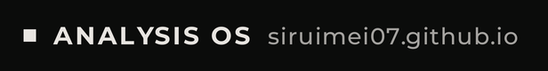

<picture>
  <source media="(prefers-reduced-motion: reduce) and (prefers-color-scheme: dark)" srcset="./assets/loading-static-dark.png" />
  <source media="(prefers-reduced-motion: reduce)" srcset="./assets/loading-static-light.png" />
  <source media="(prefers-color-scheme: dark)" srcset="./assets/loading-dark.png" />
  
</picture>

多伦多大学本科生，用统计、经济与量化理解世界。 
Undergraduate at the University of Toronto — statistics, economics &amp; quant.

  <a href="https://siruimei07.github.io/"><picture>
  <source media="(prefers-color-scheme: dark)" srcset="./assets/sections/button-site-dark.png" />
  
</picture></a>
  <a href="mailto:sirui.mei07@gmail.com"><picture>
  <source media="(prefers-color-scheme: dark)" srcset="./assets/sections/button-mail-dark.png" />
  
</picture></a>

<picture>
  <source media="(prefers-reduced-motion: reduce)" srcset="./assets/banner-static.png" />
  
</picture>

<picture>
  <source media="(prefers-color-scheme: dark)" srcset="./assets/sections/header-projects-dark.png" />
  
</picture>

<!-- PUBLIC-REPOS:START -->
| Repository | Description | Language |
| :--- | :--- | :--- |
| [rea](https://github.com/siruimei07/rea) · fork | Reverse engineer anything with agents, from app behavior down to native binaries. | TypeScript |
| [siruimei07.github.io](https://github.com/siruimei07/siruimei07.github.io) | personal website | TypeScript |
| [Folio](https://github.com/siruimei07/Folio) | 给学生用的 Windows 桌面资料库：按「学期 → 课程」整理资料，多标签、Ctrl+K 搜索、应用内预览，像 Git 一样记录每次改动并备份到 iCloud Drive。Tauri 2 + React + Rust，开发中。 | TypeScript |
| [UofT-Courses-Programs](https://github.com/siruimei07/UofT-Courses-Programs) | — | TypeScript |
| [GUI-for-RePKG](https://github.com/siruimei07/GUI-for-RePKG) | An extensible C# WPF frontend with an Endfield-inspired maximal UI, rich motion, responsive navigation, and backend extension points. | C# |
| [Stronghold-Protocol](https://github.com/siruimei07/Stronghold-Protocol) · fork | 明日方舟「卫戍协议：盟约」非官方同人复刻：浏览器自走棋塔防，单人或 1–4 人联机合作（非商业） | JavaScript |
<!-- PUBLIC-REPOS:END -->

<picture>
  <source media="(prefers-color-scheme: dark)" srcset="./assets/sections/header-activity-dark.png" />
  
</picture>

  <picture>
    <source media="(prefers-color-scheme: dark)" srcset="./assets/metrics/isocalendar-dark.4fd104c38025133f.svg" />
    
  </picture>
  <picture>
    <source media="(prefers-color-scheme: dark)" srcset="./assets/metrics/languages-card-dark.559c17c390dc418f.svg" />
    
  </picture>

  <picture>
    <source media="(prefers-color-scheme: dark)" srcset="./assets/metrics/activity-dark.4a7deacbb75ceb0e.svg" />
    
  </picture>
  <picture>
    <source media="(prefers-color-scheme: dark)" srcset="./assets/metrics/traffic-dark.ebd7697370727d60.svg" />
    
  </picture>

Fan-made tribute to Arknights · Rhine Lab, matching <a href="https://siruimei07.github.io/">my website</a>. 「明日方舟」「莱茵生命」及相关名称与标志版权归上海鹰角网络科技有限公司（Hypergryph）所有，本页与官方无关。
